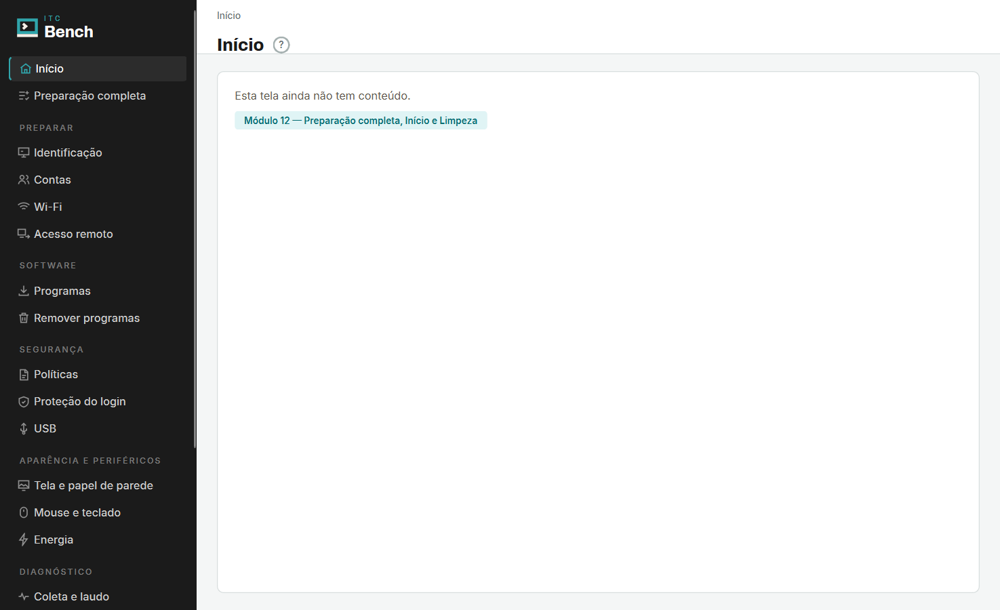
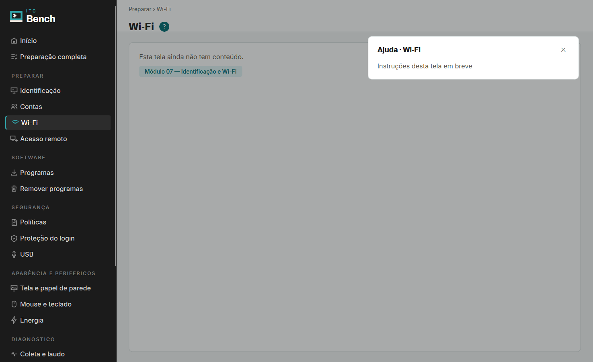

# Módulo 01 — Esqueleto do app

**Branch:** `feat/modulo-01-esqueleto` · **Data:** 2026-11-03 · **ADR:** ADR-010

## O que entrou

| Item | Onde |
|---|---|
| Manifesto e lock (Python 3.13, PySide6 6.12.0, uv ≥0.12.17 <0.13) | `pyproject.toml`, `uv.lock`, `.python-version` |
| Comandos de ambiente, execução, lint e teste | `AGENTS.md` → Comandos úteis |
| `__version__` único (`0.1.0`), lido pelo hatchling | `src/itc_bench/__init__.py` |
| Entrada com UAC, `--dev`, `--teste` | `src/itc_bench/__main__.py`, `nucleo/elevacao.py` |
| Caminhos sem efeito no import; `inicializar()` | `nucleo/caminhos.py` |
| Log rotativo 1 MiB × 5 arquivos (`bench.log` + 4) | `nucleo/log.py` |
| Mesmo log na tela Registro, ao vivo | `ui/log_qt.py`, `ui/janela.py` |
| Tema, fontes embutidas, 20 ícones, símbolo | `ui/tema.py`, `recursos/` |
| Barra lateral em 7 grupos, 20 telas vazias com "?" e módulo | `ui/navegacao.py`, `ui/janela.py` |

## Decisões de implementação

- **Elevação:** `precisa_elevar()` e `comando_elevado()` são puras; só `pedir_elevacao()` chama
  `ShellExecuteW("runas")`. Fora do PyInstaller, reabre com `pythonw -m itc_bench`.
- **`--dev` sem admin e log criado por execução elevada:** no Windows, quem cria o arquivo em
  `%ProgramData%` vira dono com controle total (`PROPRIETÁRIO CRIADOR`), e os outros usuários ficam
  com leitura. Resultado:
  - mesmo usuário, elevado antes e sem elevação agora: continua escrevendo no mesmo `bench.log`;
  - outro usuário sem admin: `PermissionError` → o log vai para
    `%LOCALAPPDATA%\ITC\Bench\logs\bench.log` e a primeira linha avisa onde ficou.
- **Ícones:** o HTML de design tem 20 ícones (um por item), não 18; extraídos todos, com
  `stroke="currentColor"` trocado pela cor na hora de desenhar.
- **Barra lateral rola:** 20 itens não cabem em 720 px; em telas de 768p a barra rola em vez de
  esticar a janela.

## Verificação

| # | Cenário | Como | Resultado real |
|---|---|---|---|
| 1 | Lint | `uv run ruff check .` / `ruff format --check .` | All checks passed |
| 2 | Tipos | `uv run mypy` (strict) | Success: no issues found in 13 source files |
| 3 | Testes | `uv run pytest` | 14 passed |
| 4 | `--teste` abre e fecha | `uv run itc-bench --teste` | código 0; log com "iniciado", "Modo teste: janela aberta; fechando." e "Encerrado com código 0." |
| 5 | Importar não cria nada | `test_importar_pacote_nao_cria_nada` (subprocesso importa todos os módulos, inclusive a UI, com `PROGRAMDATA`/`LOCALAPPDATA` vazios) | passou; pastas temporárias continuam vazias |
| 6 | `--dev` abre sem admin | `runas /trustlevel:0x20000 "itc-bench.exe --dev --teste"` | `admin=False`, código 0, log em `C:\ProgramData\ITC\Bench\logs` |
| 7 | Sem `--dev` pede UAC | decisão: `test_precisa_elevar`, `test_pedir_elevacao_chama_runas` (mock) | passou. **Pedido real de UAC: verificação manual pendente** do responsável, em sessão sem elevação: `uv run itc-bench` deve abrir o aviso do Windows; recusar mostra "A elevação foi recusada" e sai com 1 |
| 8 | `--dev` sem admin com log de execução elevada, mesmo usuário | log criado elevado; depois cenário 6 | grava no mesmo `bench.log` (ACL: usuário dono com `(F)`) |
| 9 | Idem, outro usuário sem permissão de escrita | pasta temporária com ACL só leitura para Usuários, dono Administradores; `runas /trustlevel` com `PROGRAMDATA` apontando para ela | código 0; aviso "Sem permissão em …; log gravado em …\la\ITC\Bench\logs"; teste automatizado `test_sem_permissao_vai_para_localappdata` |
| 10 | Rotação no limite | `test_rotacao_no_limite` (~6,6 MiB escritos) | exatamente `bench.log`, `.1`…`.4`, cada um ≤ 1 MiB |
| 11 | 7 grupos, 20 itens, cada item abre sua tela com título e módulo | `test_sete_grupos_e_vinte_itens`, `test_cada_item_abre_sua_tela_com_modulo` | passou |
| 12 | "?" abre e fecha o pop-up | `test_botao_ajuda_abre_e_fecha_popup` | passou; texto "Instruções desta tela em breve" |
| 13 | Fontes e ícones | `test_fontes_embutidas` (Archivo, Inter), `test_icones_e_simbolo_renderizam` | passou |
| 14 | Captura real | `01-esqueleto/inicio.png`, `01-esqueleto/wifi-ajuda.png` (janela real, escala 125%) | abaixo |

## Captura comparada com o design

Igual ao design: barra `#1B1B1B` com símbolo escuro e lockup ITC/Bench, rótulos de grupo em caixa
alta, ícones cinza e ciano no item ativo com filete à esquerda, trilha `Grupo › Tela`, título em
Archivo 800 com "?" redondo, "?" preenchido em ciano com a ajuda aberta, véu escuro e cartão de 420 px
no canto superior direito.

Diferente:
- **Rodapé:** mostra hostname e usuário reais e `Bench 0.1.0`; o design mostra um exemplo.
- **Contadores** (`6/9` em Preparação, `1` em Proteção) não existem: dependem dos Módulos 11–12.
- **Barra de título** é a nativa do Windows, não a desenhada (cinza com símbolo).
- **Véu da ajuda** cobre só a área principal; no design cobre também a barra lateral.
- **Altura:** a barra lateral passa de 720 px e rola; no design o recorte de 720 px esconde os
  últimos itens.
- **Medidas:** fontes em px do Qt numa tela a 125% ficam um pouco maiores e mais espaçadas que no
  HTML; a janela abre com 1180 × 720 lógicos.
- **Ações à direita do título** e o conteúdo das telas: fora do escopo.

## Fora do escopo

Login, API, ações no Windows, instalador, `.ico` (Módulo 14).
